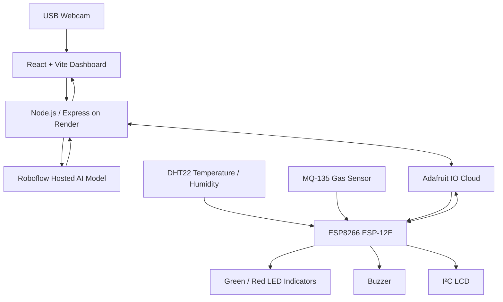

# FruitFresh-AI 🍎

**AI-powered fruit condition monitoring with IoT sensors and cloud alerts.**

FruitFresh-AI combines live camera-based fruit-condition detection with environmental monitoring. The web dashboard displays AI predictions and sensor readings, while an ESP8266 device reads temperature, humidity, and a gas-sensor signal. Adafruit IO carries the cloud sensor data and spoilage-alert state.

> **Important:** This is a prototype for visual screening and environmental monitoring. AI predictions and MQ-135 readings do not prove that food is safe or unsafe to eat. Inspect fruit and follow appropriate food-safety guidance.

## Features

- Live webcam capture in a React dashboard.
- Hosted Roboflow inference for fruit-condition classes, including `rotten`, `ripe`, `unripe`, and other model classes.
- Bounding boxes, labels, and confidence scores on the analyzed frame.
- ESP8266 ESP-12E hardware using a DHT22, MQ-135, and I²C LCD.
- Adafruit IO feeds for temperature, humidity, MQ-135 signal, and spoilage-alert state.
- Spoilage alert logic with configurable confidence and consecutive-frame thresholds.
- Red/green LED indicators and buzzer for local alerts.
- Node.js/Express backend that protects service credentials from the browser.
- Responsive dashboard suitable for desktop and mobile browsers.
- Detection-history storage is **not included** in the no-history version.

## Architecture



In the direct-Adafruit firmware mode, the ESP8266 publishes sensor readings and subscribes to the `spoilage-alert` feed. The backend reads cloud sensor feeds and publishes an alert when its AI trigger logic is met.

If using the **client-managed dashboard Settings bridge** firmware instead, follow the Settings-bridge README supplied with that version and use its `DEVICE_CONFIG_TOKEN` mechanism. Do not mix the direct-AIO firmware and bridge firmware: they use different credential flows.

## Hardware components

| Component | Purpose |
|---|---|
| ESP8266 ESP-12E / NodeMCU | Reads sensors and communicates over Wi-Fi |
| DHT22 module | Ambient temperature and relative humidity |
| MQ-135 module | Broad gas-response signal; use as experimental data |
| I²C LCD (commonly 16×2) | Displays local readings and device status |
| Green LED | Normal/clear status indicator |
| Red LED | Spoilage alert indicator |
| Active buzzer or driven buzzer module | Audible spoilage warning |
| Resistors, wires, suitable power supply | Safe connections and power |
| USB webcam + computer/browser | Image capture and dashboard use |

## ESP8266 wiring

The table below assumes a NodeMCU-style ESP8266 ESP-12E board. Confirm the labels on your actual board before wiring.

### DHT22 (3-pin module)

| DHT22 pin | ESP8266 pin |
|---|---|
| VCC / `+` | 3V3 |
| DATA / `OUT` | D4 (GPIO2) |
| GND / `-` | GND |

### I²C LCD

| LCD pin | ESP8266 connection |
|---|---|
| GND | GND |
| VCC | Suitable supply for the LCD module |
| SDA | D2 (GPIO4), through a level shifter when needed |
| SCL | D1 (GPIO5), through a level shifter when needed |

Many I²C LCD backpacks are powered at 5 V and may pull SDA/SCL up to 5 V. ESP8266 GPIOs are **not 5 V tolerant**. Check the backpack's bus voltage and use a bidirectional I²C level shifter if the bus is pulled to 5 V.

### MQ-135

| MQ-135 pin | Connection |
|---|---|
| VCC | Suitable supply for the module, often 5 V |
| GND | Common GND with ESP8266 |
| AO | A0 only after checking voltage range and using appropriate input scaling |
| DO | Not used in the current firmware unless specifically implemented |

The bare ESP8266 ADC input is nominally limited to about 1.0 V. Some development boards add an onboard divider, but the limit varies by board. Do not connect AO directly to A0 until the board's A0 range and module output are known. A 47 kΩ series resistor and 10 kΩ resistor from the A0 junction to GND reduce a 5 V signal to about 0.88 V, but check the actual board specification and verify with a multimeter first. The extra divider may make readings lower on boards that already have an onboard divider.

### LEDs and buzzer

| Output | ESP8266 pin | Connection |
|---|---|---|
| Green LED | D7 (GPIO13) | GPIO → 220–330 Ω resistor → LED anode; cathode → GND |
| Red LED | D5 (GPIO14) | GPIO → 220–330 Ω resistor → LED anode; cathode → GND |
| Buzzer module input | D6 (GPIO12) | Module signal/input pin |

Use **one resistor per LED**. Do not connect an LED directly to a GPIO. Use a transistor/driver for a buzzer needing 5 V or more current than a GPIO can safely supply. Connect all required grounds together. Power the circuit off before changing wiring.

## Adafruit IO feeds

Create the following feed keys in the Adafruit IO account used by the project:

| Feed key | Contents |
|---|---|
| `temperature` | DHT22 temperature reading in °C |
| `humidity` | DHT22 relative humidity in % |
| `mq135` | Raw MQ-135 ADC signal; not ppm |
| `spoilage-alert` | `1` = alert active, `0` = alert clear |

Feed keys must match the environment configuration and the firmware. The Adafruit IO username and key must belong to the same account that owns these feeds.

## Software requirements

- Node.js and npm
- Git
- Arduino IDE with ESP8266 board support
- Libraries matching the installed firmware, typically:
  - Adafruit MQTT Library
  - Adafruit DHT sensor library
  - Adafruit Unified Sensor
  - LiquidCrystal I²C library
  - ArduinoJson if required by the selected firmware version
- A Roboflow account/model with an API key
- An Adafruit IO account
- A Render account for hosting

The model configured in the backend is `fruit-ripening-process/2`. Confirm that your Roboflow account and deployment use the expected model version.

## Local development

### 1. Configure environment variables

Create `.env` in the repository root (next to `server/` and `web/`). Keep real credentials out of Git.

```env
NODE_ENV=development
PORT=5000
ROBOFLOW_API_KEY=YOUR_ROBOFLOW_API_KEY
AIO_USERNAME=YOUR_ADAFRUIT_USERNAME
AIO_KEY=YOUR_ADAFRUIT_IO_KEY
AIO_TEMPERATURE_FEED=temperature
AIO_HUMIDITY_FEED=humidity
AIO_MQ135_FEED=mq135
AIO_SPOILAGE_FEED=spoilage-alert
ROTTEN_ALERT_THRESHOLD=0.70
ROTTEN_TRIGGER_FRAMES=2
ROTTEN_CLEAR_FRAMES=3
```

This is an example only. Use the exact variable names required by the version of `server/index.js` you deploy. If you use the dashboard Settings bridge, it can additionally require `RENDER_API_KEY`, `RENDER_SERVICE_ID`, `DASHBOARD_SETTINGS_PASSWORD`, and `DEVICE_CONFIG_TOKEN`; follow that version's dedicated setup guide.

### 2. Install dependencies

From the repository root:

```bash
npm install --prefix server
npm install --prefix web --include=dev
```

### 3. Start the backend

In terminal 1:

```bash
node server/index.js
```

### 4. Start the frontend development server

In terminal 2:

```bash
npm run dev --prefix web
```

Open the local URL printed by Vite (usually `http://localhost:5173`). During local development, the frontend API configuration must point to the local backend at `http://localhost:5000` if the current frontend build uses an explicit API base URL.

## Deploy to Render

The repository should contain `render.yaml` at the project root. A typical single-service setup uses Render to build the React app and lets Express serve the production build.

**Build command**

```bash
npm install --prefix server && npm install --prefix web --include=dev && npm run build --prefix web
```

**Start command**

```bash
node server/index.js
```

**Health check path**

```text
/api/health
```

In Render's Environment settings, add actual secret values. Do not put real credentials in `render.yaml`, README files, React source, or public firmware templates.

Common server variables:

- `NODE_ENV=production`
- `ROBOFLOW_API_KEY`
- `AIO_USERNAME`
- `AIO_KEY`
- `AIO_TEMPERATURE_FEED=temperature`
- `AIO_HUMIDITY_FEED=humidity`
- `AIO_MQ135_FEED=mq135`
- `AIO_SPOILAGE_FEED=spoilage-alert`
- `ROTTEN_ALERT_THRESHOLD=0.70`
- `ROTTEN_TRIGGER_FRAMES=2`
- `ROTTEN_CLEAR_FRAMES=3`

If the Settings bridge is enabled, add its required Render API/service/password/device-token variables according to its separate guide. The Render service must be configured with permissions appropriate to update its environment and redeploy. Never expose a Render API token to the browser.

After deployment, test the actual public URL:

- `/api/health` — backend status and configuration flags
- `/api/sensors` — latest cloud sensor readings
- `/api/alerts` — spoilage alert state, if this route is enabled in the deployed backend
- `/` — dashboard

## Spoilage alert behavior

Typical default settings are:

```env
ROTTEN_ALERT_THRESHOLD=0.70
ROTTEN_TRIGGER_FRAMES=2
ROTTEN_CLEAR_FRAMES=3
```

- A visual prediction must have class `rotten` and confidence at or above the threshold.
- The backend requires the configured number of qualifying consecutive frames before activating an alert.
- The backend publishes `1` to `spoilage-alert` when active and `0` when cleared.
- The ESP8266 subscribes to the feed and operates the red LED and buzzer for an active alert; the green LED indicates clear/normal state if configured that way.
- If the webcam stops, the backend cannot detect newly visible fruit. Cloud/network outages may delay alerts.

Threshold tuning affects sensitivity. Lower thresholds may create more false alarms; higher thresholds may miss some cases. Validate settings with different fruits and lighting. This alert is an AI-based visual warning, not a food-safety determination.

## Security checklist

- Keep `.env` and `firmware/secrets.h` out of Git.
- Include `.env.example` or `secrets.example.h` only with placeholders, never real keys.
- Rotate any API key that was exposed in screenshots, logs, commits, or public files.
- Keep the Roboflow and Adafruit keys on the backend or in the appropriate private device configuration; never embed backend secrets in the React frontend.
- If the dashboard has client-managed Settings, protect it with a strong admin password and keep the Render API token exclusively on the server.
- Before commercial use, configure TLS certificate validation for ESP8266 connections; do not rely on insecure TLS modes.

## Troubleshooting

| Symptom | Checks |
|---|---|
| Render build says `vite: not found` | Use `npm install --prefix web --include=dev` before `npm run build --prefix web`. |
| Build cannot resolve `./index.css` | Confirm `web/src/index.css` exists if imported by `web/src/main.jsx`, or remove the import if that file is not used. |
| Adafruit API returns HTTP 401 | Check AIO username/key, regenerate keys if exposed, update Render and device credentials for the selected firmware mode, and confirm feeds belong to that account. |
| ESP8266 MQTT `Connection failed` | Check Wi-Fi internet access, MQTT port/TLS support, username/key, and feed name. Some networks block MQTT port 8883. |
| LCD blank | Check LCD supply, contrast potentiometer, I²C address (often `0x27` or `0x3F`), SDA=D2, SCL=D1, and safe I²C voltage levels. |
| DHT22 read fails | Check 3V3, GND, DATA=D4, sensor type, and library. |
| MQ-135 reading looks wrong | Verify A0 input limit and divider wiring; readings are raw, uncalibrated data and vary during warm-up. |
| LED is dim | Check LED polarity and use the correct 220 Ω or 330 Ω resistor, not 220 kΩ. Use a proper driver if a higher-current indicator is needed. |
| AI alert does not reach hardware | Verify `/api/alerts`, cloud `spoilage-alert` value, ESP8266 MQTT subscription status, and common ground/output wiring. |

## License

Add a license file only when you have decided which license applies to this project. Until then, no license is implied by this README.
